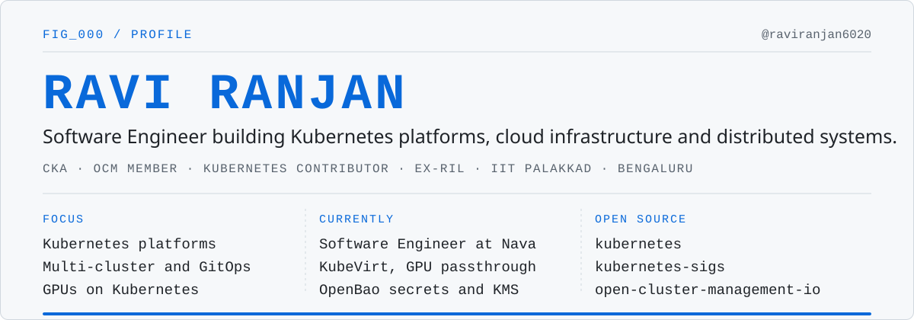
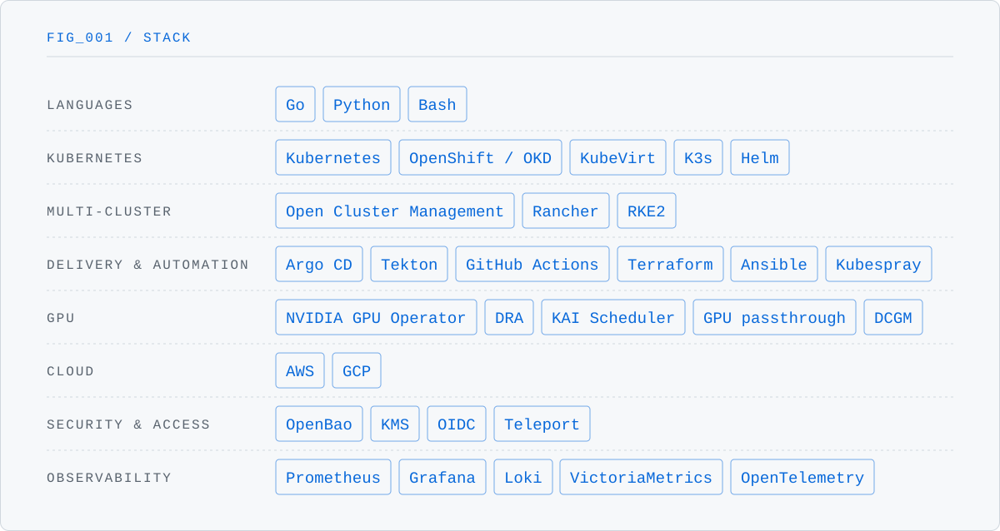

<picture>
  <source media="(prefers-color-scheme: dark)" srcset="./assets/header-dark.svg" />
  
</picture>
  
<picture>
  <source media="(prefers-color-scheme: dark)" srcset="./assets/stack-dark.svg" />
  
</picture>

### Selected contributions

Member of the [Open Cluster Management](https://github.com/open-cluster-management-io) (CNCF) GitHub org.

| Project | Contribution | Status |
|---|---|---|
| [ocm](https://github.com/open-cluster-management-io/ocm) | Report apply failures as `NotAsExpected` in ManifestWorkReplicaSet · [#1703](https://github.com/open-cluster-management-io/ocm/pull/1703) | Merged |
| [cluster-inventory-api](https://github.com/kubernetes-sigs/cluster-inventory-api) | Tests for the credential plugin's exit paths · [#87](https://github.com/kubernetes-sigs/cluster-inventory-api/pull/87) | Merged |
| [kubernetes](https://github.com/kubernetes/kubernetes) | kubelet unit tests for secret and configmap managers · [#141465](https://github.com/kubernetes/kubernetes/pull/141465) | In review |
| [kubernetes](https://github.com/kubernetes/kubernetes) | kubelet unit tests for ResourceConfig CPU and memory helpers · [#141446](https://github.com/kubernetes/kubernetes/pull/141446) | In review |
| [argocd-pull-integration](https://github.com/open-cluster-management-io/argocd-pull-integration) | Separate CRDs chart so the addon installs on any Helm version · [#251](https://github.com/open-cluster-management-io/argocd-pull-integration/pull/251) | Merged |
| [clusteradm](https://github.com/open-cluster-management-io/clusteradm) | Install the CRDs chart before the addon · [#589](https://github.com/open-cluster-management-io/clusteradm/pull/589) | In review |
| [ocm](https://github.com/open-cluster-management-io/ocm) | Build e2e images once and share them across e2e jobs · [#1740](https://github.com/open-cluster-management-io/ocm/pull/1740) | Merged |
| [ocm](https://github.com/open-cluster-management-io/ocm) | Give `latest` images a real version instead of `v0.0.0-unknown` · [#1753](https://github.com/open-cluster-management-io/ocm/pull/1753) | Merged |
| [helm-charts](https://github.com/open-cluster-management-io/helm-charts) | Upgrade and downgrade CI test for the CNCF incubation review · [#28](https://github.com/open-cluster-management-io/helm-charts/pull/28) | In review |
| [ocm](https://github.com/open-cluster-management-io/ocm) | Save e2e agent logs on failure, one summary for all e2e jobs · [#1764](https://github.com/open-cluster-management-io/ocm/pull/1764) | In review |

### Projects

| Project | What it is |
|---|---|
| [**FitJournal**](https://www.fitjournal.in) | AI fitness journal that answers "is my plan working?" Next.js, Postgres, OpenAI, Docker, Kubernetes. [Code](https://github.com/raviranjan6020/fitjournal) |
| [**ai-skills**](https://github.com/raviranjan6020/ai-skills) | Rules, skills and hooks for coding agents (Claude Code, Codex, Kiro, Cursor) from one source. |
| [**Rate Warden**](https://github.com/raviranjan6020/rate-limiter) | gRPC rate-limiting service backed by Redis, deployable with Helm. |

 

[LinkedIn](https://www.linkedin.com/in/raviranjan6020) · [CKA](https://training.linuxfoundation.org/certification/verify/) (`LF-z7d251rgm4`) · [All merged contributions](https://github.com/search?q=author%3Araviranjan6020+is%3Apr+is%3Amerged+is%3Apublic+-user%3Araviranjan6020&type=pullrequests)
